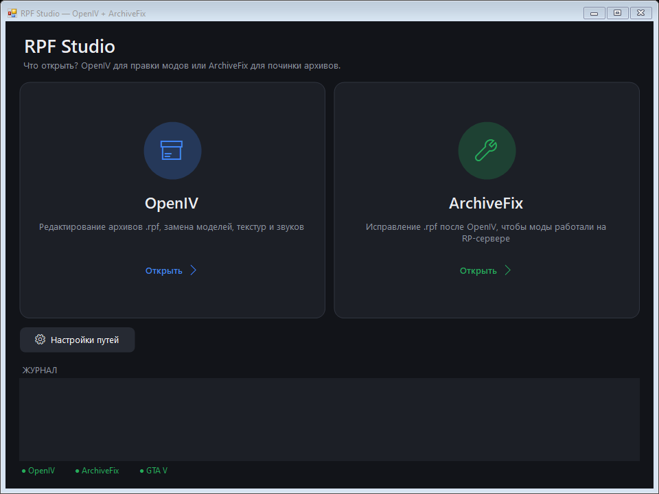
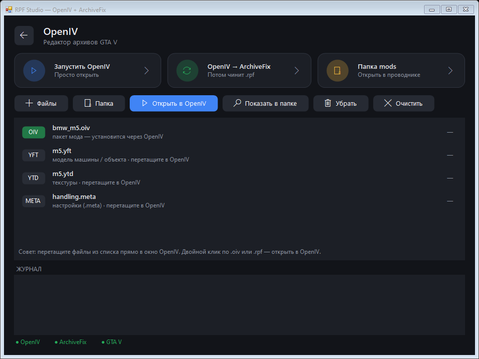
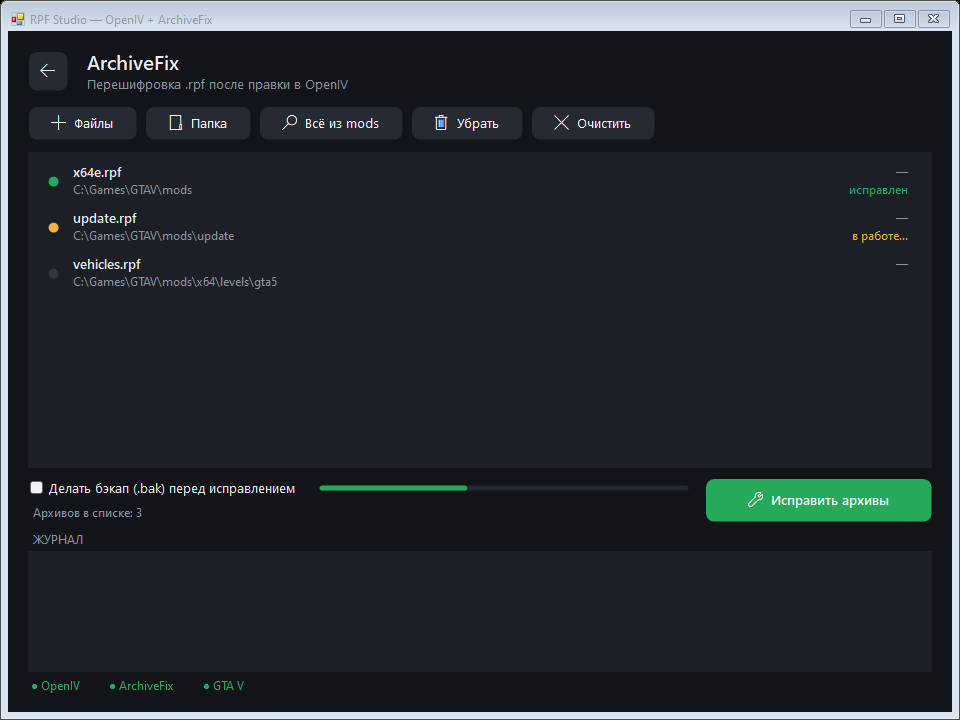

# RPF Studio

**OpenIV + ArchiveFix в одном окне** — установка модов для GTA 5 RP без возни с двумя программами.

Ставите мод в OpenIV, закрываете его — RPF Studio сама находит изменённые архивы `.rpf` и прогоняет их через ArchiveFix, чтобы мод заработал на RP-сервере.



## Скачать

Готовая программа — на странице **[Releases](../../releases/latest)**: скачайте один из архивов — `RPF-Studio-v….rar` (для WinRAR) или `RPF-Studio-v….zip` (WinRAR, 7-Zip или проводник Windows). Внутри одно и то же: `RpfStudio.exe` и гайд.

Установка не нужна. Работает на Windows 10/11 (нужен .NET Framework 4.x — он уже есть в Windows).

## Что ещё понадобится

RPF Studio — оболочка, сами программы нужно поставить отдельно:

- **OpenIV** — редактор архивов GTA V.
- **ArchiveFix** — утилита, которая перешифровывает архивы после OpenIV. Рядом с `ArchiveFix.exe` должны лежать его файлы `gtav_*.dat`. ArchiveFix **не входит** в этот репозиторий: его файлы содержат ключи шифрования игры.

Пути к OpenIV, ArchiveFix и GTA V программа ищет сама, а если не найдёт — их можно указать в «Настройках путей».

## Возможности

**Страница OpenIV**
- Запуск OpenIV одной кнопкой.
- Режим **«OpenIV → ArchiveFix»**: программа ждёт, пока вы закроете OpenIV, находит в папке игры изменённые `.rpf` и сама их исправляет.
- Список файлов мода: перетащите скачанные файлы с рабочего стола или добавьте папку мода целиком. `.oiv` и `.rpf` открываются в OpenIV двойным кликом, а `.ytd`, `.yft`, `.meta` и другие можно перетащить из списка прямо в окно OpenIV.



**Страница ArchiveFix**
- Добавление архивов перетаскиванием, через выбор файлов, папкой или «Всё из mods».
- Программа сама проверяет каждый архив и запускает ArchiveFix только для тех, что изменил OpenIV — нетронутые архивы пропускаются.
- Бэкап `.bak` перед исправлением, прогресс и статус каждого архива.



## Как поставить мод

1. Сохраните копию архивов игры, которые будете менять.
2. RPF Studio → **OpenIV** → перетащите файлы мода в список.
3. Нажмите **«Открыть в OpenIV»**, включите в OpenIV **Edit mode**.
4. Перетащите файлы мода из списка в нужную папку архива в OpenIV (путь обычно указан в readme мода).
5. Закройте **все** окна OpenIV — архивы исправятся автоматически.
6. Запускайте игру через лаунчер RP-сервера.

Подробная инструкция — в [`Гайд RPF Studio.txt`](RpfStudio/Гайд%20RPF%20Studio.txt): какие файлы куда класть, что значат статусы, что делать при ошибках.

> ⚠️ Не переименовывайте архив после ArchiveFix: шифрование привязано к имени файла.

## Сборка из исходников

Исходный код — один файл [`RpfStudio/Program.cs`](RpfStudio/Program.cs) (C#, WinForms). Ничего ставить не нужно — используется компилятор, встроенный в Windows:

```bat
RpfStudio\build.bat
```

Рядом появится `RpfStudio.exe`.

## Важно

- Проект не связан с Rockstar Games, OpenIV и авторами ArchiveFix.
- На RP-серверах разрешены не все моды. Визуальные моды (графика, звуки, машины) обычно можно, читы и всё, что даёт преимущество, — бан. Перед установкой проверьте правила своего сервера.
- Всегда делайте копию оригинальных файлов игры.

## Лицензия

[MIT](LICENSE)
